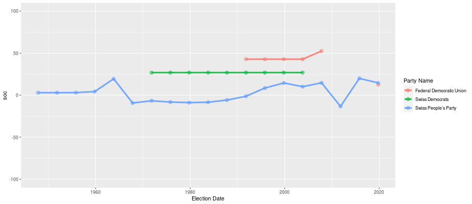

---
title: "Polarized Pluralism: Then and Now"
bibliography: references.bib
format:
  html:
    toc: false
---

How do you stop radical/extreme right parties (RERPs) from gaining more votes and power? In spite of recent electoral losses of RERPs and candidates that had already gained power in Hungary and the United States, a marked and lasting reduction of opposition RERPs' vote shares is not in sight. In Germany, the AfD topped [recent state elections](https://en.wikipedia.org/wiki/Alternative_for_Germany_election_results) and national polls. In France, the [Rassemblement National](https://en.wikipedia.org/wiki/National_Rally) is leading the polls for the presidential election, and its candidate, Marine Le Pen, is currently favored to win most run-off scenarios. In [Denmark](https://en.wikipedia.org/wiki/Danish_People%27s_Party) and [Sweden](https://en.wikipedia.org/wiki/Tid%C3%B6_Agreement), the adoption of RERP policy positions and the toleration of RERP support for the ruling government only produced limited effects in decreasing their vote shares.

Most political science analysis that is also widely shared in public debates focuses on the strategies that centrist parties can pursue. Both accommodative and dismissive strategies have received empirical support, but none has had a lasting effect on reducing voter support for RERPs [@chou2021; @hjorth2022; @krause2023].[^1] This focus on individual-level party strategies overlooks how the constellation of all parties, i.e., the party system, might exert influence on voters' decisions.

While working on the fate of democracies in the interwar period, I returned to Giovanni Sartori's classic 1976 "Parties and Party Systems" [@Sartori2005]. In it, Sartori argues that the explanation for both affective and ideological polarization is best sought at the party system level rather than in the actions and strategies of individual parties. In his "systemic" approach, Sartori describes *polarized pluralism* as a type of party system characterized by six or more parties, with government coalitions between centrist parties that were facing opposition from two opposed and extreme ends of the political spectrum.[^2]

Developed against the backdrop of the tumultuous politics of [interwar Europe](https://en.wikipedia.org/wiki/Interwar_period), and the early post-war [French 4th Republic](https://en.wikipedia.org/wiki/French_Fourth_Republic) and [Italian](https://en.wikipedia.org/wiki/History_of_the_Italian_Republic) party systems, Sartori argued that *the centrifugal or polarizing tendencies of these party systems derive from the lack of competition over centrist policy ideas/the median voter*. Because centrist parties occupy the center ideologically and they form coalitions across the center, rather than alternating between left and right governments, actual partisan competition takes place between the center and the extremes. As the parties of both extremes do not join coalitions together and parties of the center do not coalesce with the extremes, government alternation does not take place. As a result, dissatisfaction with the status quo moves more voters towards the extremes.

There are a number of problems with Sartori's model. For example, it is unclear whether the verbal model is logically consistent.[^3] Moreover, it is an open question whether today's party systems are really facing extreme parties on both sides of the political spectrum. The rise of parties like [La France Insoumise](https://en.wikipedia.org/wiki/La_France_Insoumise) and the electoral victory of a more radical chapter of [Die Linke](https://en.wikipedia.org/wiki/Die_Linke) in the [recent Berlin state election](https://en.wikipedia.org/wiki/2026_Berlin_state_election) in Germany might suggest as much, but more systematic insights are needed.[^4]

Even if we reasonably disagree to what extent a particular party system approximates polarized pluralism, I argue that blocked government alternation alone puts centrist parties in a quagmire.[^5] Staying in the center and excluding radical parties from government coalitions increases the flight to the extremes (a cost borne under the status quo). Yet moving away from the center in order to re-enable left-right alternation and thereby moderating dynamics has even greater short-run costs. For one, it risks expelling centrist parties from government power if the other political side wins. For another, it might condemn centrist parties to the role of junior partners or even irrelevance if the now established RERPs (and possibly radical left parties) become the new main contenders for voters in the long run -- a possibility suggested by the realignment thesis.

Accepting Sartori's hypothesis of systemic effects would offer an explanation of the recent electoral rise of RERPs that neither builds exclusively on voter demand, nor on individual party actions, but on pressures that arise from party system characteristics. It would also suggest that suggestions for strategies to centrist parties (accommodate or exclude RERPs) are incomplete or conditional on party system dynamics. 

Finally, Sartori's conclusion draws on neither of the existing party strategies but suggests a third option: moderate anti-system parties over time. 
To my knowledge no well-identified study exists that links any particular strategy of other parties to successful moderation.[^6] At the anecdotal level, the short-lived attempt to exclude the radical right [Swiss People's Party](https://en.wikipedia.org/wiki/Swiss_People%27s_Party) (SVP) from power [in 2007](https://en.wikipedia.org/wiki/2007_Swiss_Federal_Council_election) and its [re-integration in 2008](https://en.wikipedia.org/wiki/2008_Swiss_Federal_Council_election) shows the difficulties in establishing a link between particular party strategies and moderating the policy proposals of RERPs.[^7] According to Manifesto Project data, the SVP program moderated in the following [2011 elections](https://en.wikipedia.org/wiki/2011_Swiss_federal_election), but it has reverted to more radical positions on the social progressive-conservative divide in later elections (see @fig-svp).[^8]

{#fig-svp}

If neither accommodation nor exclusion succeeds in durably reducing RERP vote shares or moderating them, an alternative potential outcome is that RERPs are here to stay, and to stay radical.[^9] The logical follow-up question is how to deal with this potential outcome. In the absence of many cases of successful reductions in vote shares, empirical analyses that set out to test potential interaction effects between individual party strategies and party system constellations are difficult. Exploring the potential for moderation and associated strategies by returning to the historical cases of Communist and some Social Democratic parties might offer some empirical leverage. Better policy advice also requires new theory building that models the interactions between different levels of analysis, the party and the party system.

## References {.unnumbered}

::: {#refs}
:::

[^1]: Reading the literature on party strategies, it is not clear to me if the intention of dismissive strategies such as cordon sanitaires includes reducing RERP voter appeal. Giovanni Capoccia suggests that the exclusion of the Rex party in interwar Belgium had that effect [@Capoccia2005]. More commonly, I find that dismissive strategies are justified by the desire to protect liberal democratic institutions from RERP attacks from the inside. However, if the cost is increasing vote shares for RERPs, the strategy may not be tenable in the long run.

[^2]: Polarized pluralism has eight defining characteristics. (1) relevant anti-system parties (2) on both sides of the political spectrum, (3) at least one central party that impedes competition over the center, (4) clear ideological differences between the extremes, (5) a flow of voters to the extremes, (6) parties do not pursue catch-all strategies, (6) irresponsible/unrealistic opposition promises, and (8) outbidding on the flanks.

[^3]: The one formalization of Sartori's model that I could find suggests that "centrifugal drives do not prevail, because even the anti-system parties are ultimately forced to some centripetal shifts."

[^4]: It is a surprisingly hard question to answer for both conceptual and empirical reasons, as I will discuss in a future post on how to think about ideological/political polarization. For some thoughts on the topic, see my work with Lea Kaftan in [Democratization](https://www.tandfonline.com/doi/full/10.1080/13510347.2025.2537218).

[^5]: Following Jonah Schulhofer-Wohl's definition of a quagmire as bearing costs under the status quo but paying even greater costs when trying to escape from it.

[^6]: There are some observational studies that suggest moderation after government participation, and one well-designed study on the deradicalization of socialist parties that demonstrates a moderating effect of government inclusion [@tiratelli2024].

[^7]: The Swiss parliament actually voted to replace divisive with moderate SVP members in the [executive council](https://en.wikipedia.org/wiki/Federal_Council_(Switzerland)). The scheme led to a [split in the SVP](https://en.wikipedia.org/wiki/Conservative_Democratic_Party_of_Switzerland) that saw the expulsion of the elected moderates and therefore the withdrawal of the SVP from government positions.

[^8]: Since Manifesto data are only available at election time, it is hard to attribute the moderation effect between 2007 and 2011 to the SVP's re-integration into government.

[^9]: Both cleavage-based realignment theory and norms-change theory support the "here-to-stay" outcome [@bornschier2024; @Valentim2024a]. 

