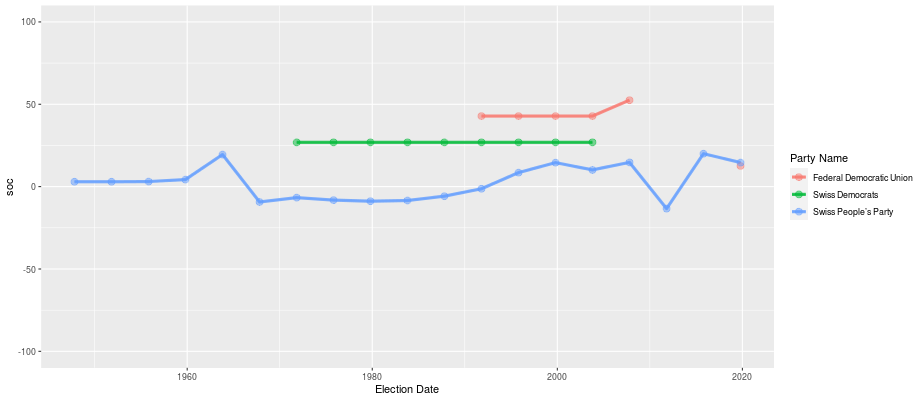

How do you stop radical/extreme right parties (RERPs) from gaining more votes and power? Recent [state elections in Germany](https://en.wikipedia.org/wiki/2026_Saxony-Anhalt_state_election), the [upcoming Spanish parliamentary elections](https://en.wikipedia.org/wiki/2026_Spanish_general_election), and the [looming presidential elections in France](https://en.wikipedia.org/wiki/2027_French_presidential_election) see RERPs as frontrunners or potential coalition partners. Political scientists are in high demand to comment on these results and frequently make suggestions on how to confront far-right parties. 

The two most commonly suggested strategies to reduce RERP vote shares differ markedly. The first effectively excludes RERPs politically; it involves ostracizing their political positions, refusing joint votes, and not compromising with them regardless of the issue [@krause2023].[^1] Building on spatial theories of voting, the second strategy is to take similar but less radical policy positions to win back ideologically right-wing voters [@hjorth2022; @chou2021]. Well-designed studies exist that yield support for both strategies, though academics more commonly promote ostracizing RERPs.

Regardless of which strategies centrist parties have adopted though, a marked and lasting reduction of RERPs' vote share has not occurred. In Germany, the AfD topped [recent state elections](https://en.wikipedia.org/wiki/Alternative_for_Germany_election_results) and national polls. In France, the [Rassemblement National](https://en.wikipedia.org/wiki/National_Rally) is leading the polls for the presidential election, and its candidate, Marine Le Pen, is currently favored to win most run-off scenarios. In [Denmark](https://en.wikipedia.org/wiki/Danish_People%27s_Party) and [Sweden](https://en.wikipedia.org/wiki/Tid%C3%B6_Agreement), the adoption of RERP policy positions and the toleration of RERP support for the ruling government only produced limited effects in decreasing their vote shares.[^2]

A third option that gets less publicity is the moderation of RERP policy positions and their eventual inclusion into the political mainstream. Yet to my knowledge no well identified study exists that links any particular strategy of other parties to successful moderation.[^3] At the anecdotal level, the short-lived attempt to exclude the radical right [Swiss People's Party](https://en.wikipedia.org/wiki/Swiss_People%27s_Party) (SVP) from power [in 2007](https://en.wikipedia.org/wiki/2007_Swiss_Federal_Council_election) and its [re-integration in 2008](https://en.wikipedia.org/wiki/2008_Swiss_Federal_Council_election) shows the difficulties in establishing a link between particular party strategies and moderating the policy proposal of RERPs.[^4] According to Manifesto Project data, the SVP program moderated in the following [2011 elections](https://en.wikipedia.org/wiki/2011_Swiss_federal_election), but it has reverted to more radical positions on the social progressive-conservative divide in later elections (see @fig-svp).[^5]

{#fig-svp}

If neither accommodation nor exclusion is clearly successful in durably reducing RERP vote shares or moderating them, an alternative potential outcome is that RERPs are here to stay, and to stay radical.[^6] It is not a particularly appealing option but one that political scientists need to conceptually acknowledge and theorize.

Two theories offer explanations for the "here-to-stay" outcome. First, proponents of cleavage theory argue that substantial realignment of voters and parties has taken place as a consequence of globalization [@bornschier2024]. Instead of old center-left and center-right party competition over economic outcomes, the new battlefield of European politics is cultural and is fought over by parties from the New Left (read Green parties) and the Far Right (RERPs). Second, norms that previously prohibited supporting RERPs have weakened or disappeared [@Valentim2024a]. Ultimately, both of these explanations have less to say about party strategies and the subsequent competitive interactions between parties.

While working on the fate of democracies in the interwar period, I returned to Giovanni Sartori's classic 1976 "Parties and Party Systems" [@Sartori2005]. In it, Sartori argues that the explanation for polarization is best sought at the party system level rather than in the actions and strategies of individual parties. In his "systemic" approach, Sartori describes *polarized pluralism* as a type of party system characterized by six or more parties, with government coalitions between centrist parties that were facing opposition from two opposed and extreme ends of the political spectrum.

Developed against the backdrop of the tumultuous politics of [interwar Europe](https://en.wikipedia.org/wiki/Interwar_period), and the early post-war [French 4th Republic](https://en.wikipedia.org/wiki/French_Fourth_Republic) and [Italian](https://en.wikipedia.org/wiki/History_of_the_Italian_Republic) party systems, Sartori argued that *the centrifugal or polarizing tendencies of these party systems derive from the lack of competition over centrist policy ideas/the median voter*. Because centrist parties occupy the center ideologically and they form coalitions across the center, rather than alternating between left and right governments, actual partisan competition takes place between the center and the extremes. As the parties of both extremes do not join coalitions together and parties of the center do not coalesce with the extremes, government alternation does not take place. As a result, dissatisfaction with the status quo moves more voters towards the extremes.

There are a number of problems with Sartori's model. For example, it is unclear whether the verbal model is logically consistent.[^7] Moreover, it is an open question whether today's party systems are really facing extreme parties on both sides of the political spectrum. The rise of parties like [La France Insoumise](https://en.wikipedia.org/wiki/La_France_Insoumise) and the electoral victory of a more radical chapter of [Die Linke](https://en.wikipedia.org/wiki/Die_Linke) in the [recent Berlin state election](https://en.wikipedia.org/wiki/2026_Berlin_state_election) in Germany might suggest as much, but more systematic insights are needed.[^8]

Even if we reasonably disagree to what extent a particular party system approximates polarized pluralism, I argue that blocked government alternation alone puts centrist parties in a quagmire.[^9] Staying in the center and excluding radical parties from government coalitions increases the flight to the extremes (a cost borne under the status quo). Yet moving away from the center in order to re-enable left-right alternation and thereby moderating dynamics has even greater short-run costs. For one, it risks expelling centrist parties from government power if the other political side wins. For another, it might condemn centrist parties to the role of junior partners or even irrelevance if the now established RERPs (and possibly radical left parties) become the new main contenders for voters in the long run -- a possibility suggested by the realignment thesis.

Accepting Sartori's hypothesis of systemic effects would offer an explanation of the recent electoral rise of RERPs that neither builds exclusively on voter demand, nor on individual party actions, but on pressures that arise from the constellation of parties. It would also suggest that suggestions for strategies to centrist parties (integrate or exclude RERPs) are incomplete or conditional on party system dynamics. In the absence of many cases of successful reductions in vote shares, empirical analyses that set out to test conditional effects are difficult. In my view, better policy advice requires new theory building that models the interactions between different levels of analysis, the party and the party system.

## References {.unnumbered}

::: {#refs}
:::

[^1]: In Germany, this no contact approach is called the ["Brandmauer" or "firewall"](https://en.wikipedia.org/wiki/Firewall_against_the_far-right_in_Germany)

[^2]: It is possible that RERPs would have been even stronger in a world in which these strategies had not been adopted.

[^3]: There are some observational studies that suggest moderation after government participation, and one well-designed study on the deradicalization of socialist parties that demonstrates a moderating effect of government inclusion [@tiratelli2024].

[^4]: The Swiss parliament actually voted to replace divisive with moderate SVP members in the [executive council](https://en.wikipedia.org/wiki/Federal_Council_(Switzerland)). The scheme led to a [split in the SVP](https://en.wikipedia.org/wiki/Conservative_Democratic_Party_of_Switzerland) that saw the expulsion of the elected moderates and therefore the withdrawal of the SVP from government positions.

[^5]: Since Manifesto data are only available at election time, it is hard to attribute the moderation effect between 2007 and 2011 to the SVP's re-integration into government.

[^6]: One option I do not discuss here is the option of party bans. They receive quite some attention in Germany, but to my knowledge there is little evidence beyond individual case studies on their success chances.

[^7]: The one formalization of Sartori's model that I could find suggests that "centrifugal drives do not prevail, because even the anti-system parties are ultimately forced to some centripetal shifts."

[^8]: It is a surprisingly hard question to answer for both conceptual and empirical reasons, as I will discuss in a future post on how to think about ideological/political polarization. For some thoughts on the topic, see my work with Lea Kaftan in [Democratization](https://www.tandfonline.com/doi/full/10.1080/13510347.2025.2537218).

[^9]: Following Jonah Schulhofer-Wohl's definition of a quagmire as bearing costs under the status quo but paying even greater costs when trying to escape from it.
